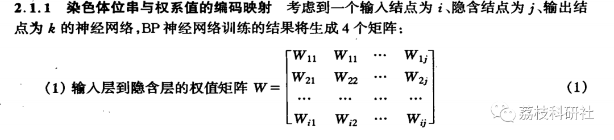
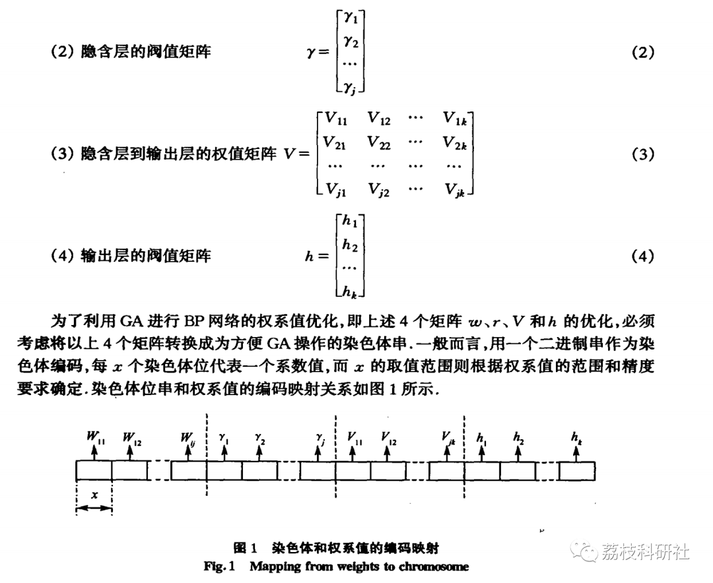
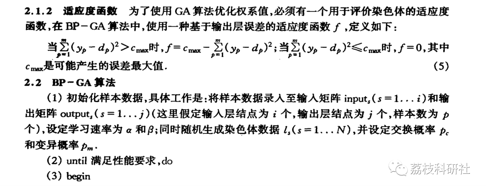
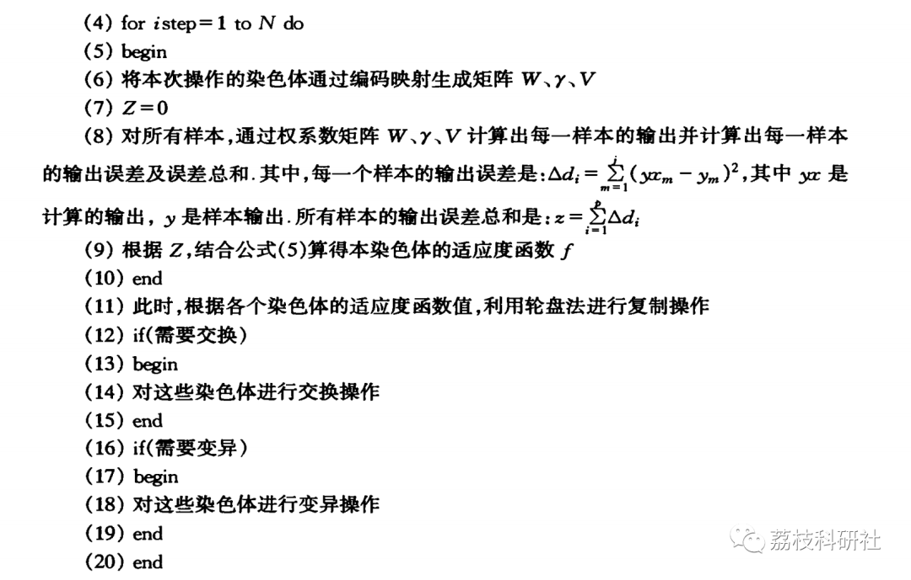
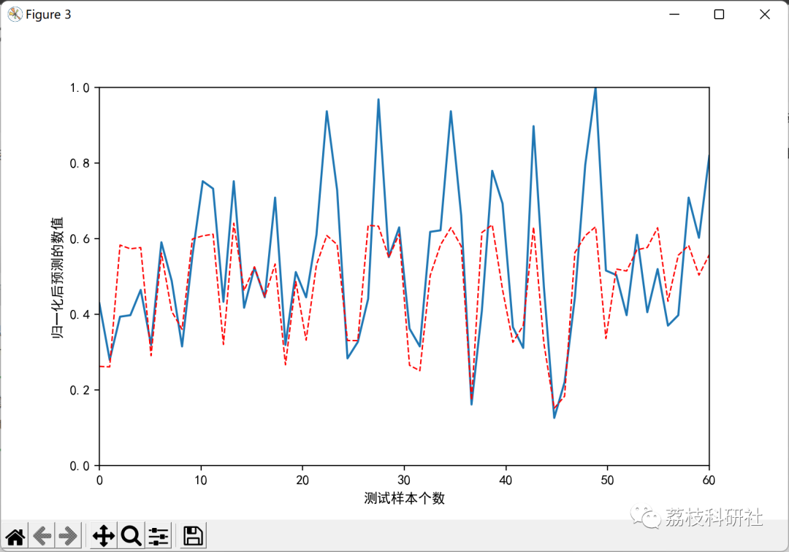
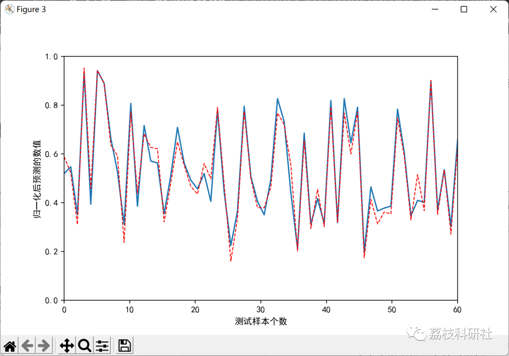

# Optimization of BP Neural Network Based on Genetic Algorithm (Python Code)

💥💥💥💞💞💞 Welcome to this blog❤️❤️❤️ 💥💥💥
🏆 Bloggers' Advantages: 🌞🌞🌞 The content of the blog strives for rigorous thinking and clear logic to facilitate readers.
⛳️ Mantra: A journey of a thousand miles is begun with a single step.
Litchi Research Society
Code Collection: Electric Power Systems, Intelligent Algorithms and Applications, Neural Network Prediction, Path Planning, Optimized Scheduling, Shop Floor Scheduling, Image Processing, Signal Processing...
🎁 Special Section Links:
🌈🌈🌈🌟🌟🌟 Electrical Code Intelligent Algorithms and Their Applications Path Planning Neural Network Prediction Optimized Scheduling Image Processing Shop Floor Scheduling Signal Processing Romantic Her
My Thoughts on Mathematical Modeling Complete Code Matters
Directory
💥1 Overview
📚2 Run Results
🎉3 References
🌈4 Python Code Implementation
💥1 Overview
The Design of BP-GA Algorithm: The BP-GA algorithm, based on genetic algorithms in the learning process of the BP neural network (hereinafter referred to as BP-GA), involves describing weights and thresholds as chromosomes, selecting an appropriate fitness function, and then iterating through GA until some form of convergence. Compared to the traditional BP learning algorithm, the advantage of the BP-GA algorithm lies in its ability to handle examples that cannot be handled by conventional methods, such as non-differentiable characteristic functions (transfer functions) or nodes without gradient information. This algorithm involves two key issues, namely the encoding mapping of chromosome bit strings and weight values, and the evaluation function.
📚2 Run Results
🎉3 References
[1] Wang Chongjun, Yu Wenzhi, Chen Zhaogang, Xie Junyuan. A Genetic Algorithm-Based BP Neural Network Algorithm and Its Application [J]. Nanjing University Journal: Natural Science Edition, 2003, 39(5): 459-466
[2] Pan Hao, Wang Xiaoyong, Chen Qiong, Huang Shaoluang. Application of Genetic Algorithm-Based BP Neural Network Technology [J]. Computer Application, 2005, 25(12): 2777-2779
🌈4 Python Code Implementation
Click the article's lower left corner to read more

## Images

<!-- PAYMENT_BLOCK -->

## Get this dataset

- Payment link (Stripe): [Buy now](https://buy.stripe.com/3cs8yP7sY87d0vu9AB)
- Payment QR code: 

<!-- /PAYMENT_BLOCK -->
